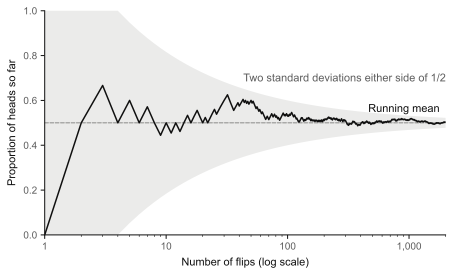
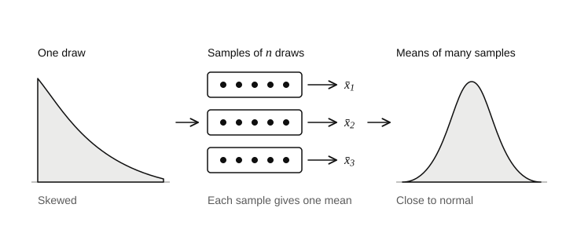

## The idea

Flip a fair coin ten times and seven heads would not surprise you. Flip it ten thousand times and seven thousand heads would. Why do averages settle down as you collect more data, and what shape does the leftover wobble take?

### The sample mean

Take random variables $X_1, X_2, \dots, X_n$ that are independent and identically distributed: each is a fresh draw from the same distribution, and no draw affects another. Call the mean of one draw $\mu$ and its variance $\sigma^2$, and assume $\sigma^2$ is finite. The sample mean is the average of the draws:

$$
\bar{X}_n := \frac{X_1 + X_2 + \dots + X_n}{n}.
$$

For coin flips, $X_i$ is 1 for heads and 0 for tails, $\mu$ is the probability of heads, and $\bar{X}_n$ is the proportion of heads so far.

Two facts from step 04 tell you almost everything. Expectation is linear, so the sample mean is centred on the right value:

$$
\mathbb{E}[\bar{X}_n] = \frac{1}{n}\bigl(\mathbb{E}[X_1] + \dots + \mathbb{E}[X_n]\bigr) = \mu.
$$

Variances of independent variables add, and multiplying a variable by $1/n$ multiplies its variance by $1/n^2$, so

$$
\operatorname{Var}(\bar{X}_n) = \frac{1}{n^2}\bigl(\operatorname{Var}(X_1) + \dots + \operatorname{Var}(X_n)\bigr) = \frac{\sigma^2}{n}.
$$

The spread of the sample mean, its standard deviation, is $\sigma / \sqrt{n}$. Four times the data halves the wobble.

### The law of large numbers

**Theorem (weak law of large numbers).** If $X_1, X_2, \dots$ are independent and identically distributed with mean $\mu$ and finite variance $\sigma^2$, then for every $\varepsilon > 0$,

$$
P\bigl(\lvert \bar{X}_n - \mu \rvert \ge \varepsilon\bigr) \to 0 \quad \text{as } n \to \infty.
$$

In words: however small a margin $\varepsilon$ you pick, the chance that the sample mean misses $\mu$ by more than that margin shrinks to nothing.

The proof is one line once you have Chebyshev's inequality, which bounds how often any variable lands far from its mean: $P(\lvert Y - \mathbb{E}[Y] \rvert \ge \varepsilon) \le \operatorname{Var}(Y) / \varepsilon^2$. Apply it to $Y = \bar{X}_n$:

$$
P\bigl(\lvert \bar{X}_n - \mu \rvert \ge \varepsilon\bigr) \le \frac{\sigma^2}{n \varepsilon^2},
$$

and the right-hand side goes to zero as $n$ grows.



The law says nothing about the count of heads catching up with the count of tails. The difference between heads and $n/2$ has standard deviation $\sqrt{n}/2$, which grows. The proportion settles because that growing difference is divided by an $n$ that grows faster. Early luck is never cancelled; it is diluted.

### The central limit theorem

The law of large numbers says where $\bar{X}_n$ ends up. The central limit theorem says what the wobble around it looks like. Measure the wobble in units of its own standard deviation:

$$
Z_n := \frac{\bar{X}_n - \mu}{\sigma / \sqrt{n}}.
$$

**Theorem (central limit theorem).** If $X_1, X_2, \dots$ are independent and identically distributed with mean $\mu$ and finite variance $\sigma^2 > 0$, then for every real number $z$,

$$
P(Z_n \le z) \to \Phi(z) \quad \text{as } n \to \infty,
$$

where $\Phi$ is the standard normal CDF from step 03.

The striking part is what the theorem does not ask for. The distribution of one draw can be skewed, lumpy or discrete; only its mean and variance survive into the limit. That is why the bell curve turns up whenever a quantity is the sum of many small independent effects.



How large must $n$ be? There is no single answer: the more skewed the distribution of one draw, the more draws the approximation needs. For proportions, a common rule of thumb asks for at least ten expected successes and ten expected failures. Simulating is the honest check.

[Simulation: flip coins and watch the running proportion](sims/coin-flips.html)

## Worked example

A fair die is rolled 600 times. Estimate the probability that more than 120 of the rolls are sixes.

**Set up.** Let $X_i$ be 1 if roll $i$ is a six and 0 otherwise. Then $\mu = 1/6$ and $\sigma^2 = \tfrac{1}{6} \cdot \tfrac{5}{6} = 5/36$. The count of sixes is $S = X_1 + \dots + X_{600} = 600\,\bar{X}_{600}$.

**Mean and spread of the count.** Multiplying the sample mean by 600 multiplies its mean by 600 and its standard deviation by 600:

$$
\mathbb{E}[S] = 600 \cdot \tfrac{1}{6} = 100, \qquad \operatorname{Var}(S) = 600 \cdot \tfrac{5}{36} = 83.\overline{3}, \qquad \text{standard deviation} \approx 9.13.
$$

**Standardise.** "More than 120 sixes" means $S \ge 121$. Because $S$ only takes whole values and the normal distribution is continuous, split the difference and use 120.5 as the boundary (the continuity correction):

$$
P(S \ge 121) \approx P\Bigl(Z > \frac{120.5 - 100}{9.13}\Bigr) = P(Z > 2.25) = 1 - \Phi(2.25) \approx 0.012.
$$

**Check.** The exact answer is a binomial sum, which a computer does in a moment:

```python
from math import comb

p = 1 / 6
exact = sum(comb(600, k) * p**k * (1 - p) ** (600 - k) for k in range(121, 601))
print(round(exact, 4))  # 0.0139
```

The approximation, 0.012, is close but a little low. With $p = 1/6$ the count is skewed to the right, so its upper tail is slightly heavier than the normal curve's. More rolls would shrink the gap.

## Exercises

1. **Check.** Each $X_i$ has variance 4. What is the standard deviation of $\bar{X}_{100}$?

   <details><summary>Hint</summary>

   Find $\operatorname{Var}(\bar{X}_{100})$ first, then take the square root.

   </details>

2. **Apply.** Using Chebyshev's inequality, how many flips of a fair coin guarantee that the proportion of heads is within 0.01 of one half with probability at least 0.95?

   <details><summary>Hint</summary>

   Set $\sigma^2 / (n \varepsilon^2) \le 0.05$ with $\sigma^2 = 1/4$ and $\varepsilon = 0.01$, and solve for $n$.

   </details>

3. **Apply.** Waiting times for a bus are independent, each with mean 10 minutes and standard deviation 10 minutes. Estimate the probability that 36 waits add up to more than 7 hours.

   <details><summary>Hint</summary>

   Find the mean and standard deviation of the total, then standardise 420 minutes.

   </details>

4. **Stretch.** Repeat exercise 2 using the central limit theorem instead of Chebyshev's inequality. Why are the two answers so different, and which would you trust?

   <details><summary>Hint</summary>

   Chebyshev's inequality holds for every distribution with that variance, so it must allow for the worst one.

   </details>

5. **Stretch.** After 1,000 flips of a fair coin you have 520 heads. A friend says the next flips should favour tails, because the proportion has to come back to one half. Explain what is wrong with the argument, using the last paragraph of the law of large numbers above.

   <details><summary>Hint</summary>

   What happens to the proportion if the next 10,000 flips are exactly half heads?

   </details>

## Further reading

- [Introduction to Probability, Grinstead and Snell, chapters 8 and 9](https://math.dartmouth.edu/~prob/prob/prob.pdf): a free textbook whose chapters on the law of large numbers and the central limit theorem go further than this step, with many exercises.
- [OpenIntro Statistics](https://www.openintro.org/book/os/): a free statistics textbook that puts the central limit theorem to work on confidence intervals and tests, the subject of step 08.
- [Seeing Theory, Brown University](https://seeing-theory.brown.edu/): interactive visualisations of probability, including the central limit theorem, to try alongside this step's simulation.
